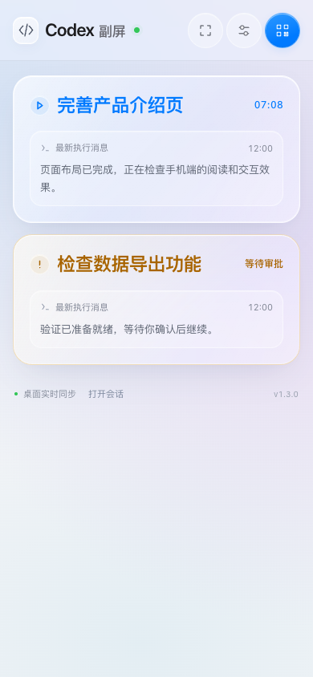
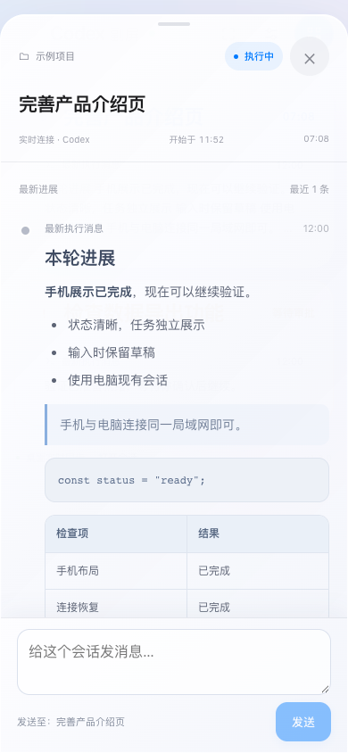

# Codex Companion · 手机副屏

把 Codex 的进展放到手边，电脑继续做其他事。

**主要用于同一局域网。副屏无需登录 Codex 账号，无需填写 API Key。电脑端已配置好 API / 中转 Token、能正常运行 Codex 的情况下，可以直接沿用现有会话。**

这是独立的社区工具，与 OpenAI 没有隶属关系。模型和中转配置仍由电脑 Codex 管理，副屏不读取认证配置、不转发 Token。查看进展不新增模型请求；发送文字会继续原会话并产生正常用量。具体中转服务是否可用，取决于电脑端和桌面协议兼容性。

<p align="center">
  
  
</p>

## 能做什么

- **一眼看进度**：顶部连接点、每任务一张卡片、名称与状态、最新消息；执行中显示分秒计时。
- **手机手动处理**：支持的审批可同意或拒绝，问题可回答，也可以给电脑已有会话发文字。
- **配对简单**：手机和电脑连同一 Wi-Fi，选电脑、输入 6 位码；之后记住设备。
- **适合常驻副屏**：Android 原生常亮和全屏，没任务时显示 24 小时制时钟。
- **适合手机阅读**：Markdown 标题、列表、引用、代码和表格；输入法只抬起输入区。
- **本机与局域网传输**：不需要另外搭云服务，不要求副屏账号或模型密钥。

## 下载并开始

从 [GitHub Releases](https://github.com/cdyyang8-droid/codex-companion/releases) 下载 Mac ZIP 和 Android APK。首次开源版本为 **1.3.0 预发布版**。

- [Mac 独立运行包 · Apple 芯片](https://github.com/cdyyang8-droid/codex-companion/releases/download/v1.3.0/codex-companion-1.3.0-macos-apple-silicon.zip)
- [Android APK](https://github.com/cdyyang8-droid/codex-companion/releases/download/v1.3.0/codex-companion-1.3.0.apk)
- [快速安装说明](docs/QUICKSTART.md)

1. **电脑**：解压 Mac ZIP，把 `Codex Companion.app` 拖进「应用程序」，先打开 Codex，再双击启动副屏。菜单栏出现「⌁ 副屏」，自动打开配对页面。
2. **手机**：安装包内的 APK，或在电脑配对页查看局域网 APK 下载地址。
3. **连接**：手机与电脑接入同一可互通局域网，App 选择电脑，输入电脑页面的 6 位码。
4. **使用**：点击任务看详情和手动操作；电脑可以切到其他软件，副屏继续显示。菜单栏可重新打开页面或退出后台服务。

Mac 包内置运行环境，普通用户无需安装 Python、Node 或 Android 开发工具。详细安装、连不上时的处理和数据目录见 [快速开始](docs/QUICKSTART.md)。

| 环境 | 当前支持情况 |
| --- | --- |
| Apple 芯片 Mac，macOS 13+ | 提供独立启动包，当前主要使用环境 |
| Intel Mac | 可按开发指南在 Intel 环境构建，当前未提供已验证下载包 |
| Android 8+ | APK；Android 11+ 支持输入区独立避让 |
| 手机浏览器 | 可用配对链接连接，常亮受系统限制 |
| Windows / Linux 电脑端 | 桌面协议连接未验证，暂不承诺支持 |

Mac App 当前只有本地 ad-hoc 签名，未做 Apple Developer ID 签名和公证。首次打开可能需在「系统设置 → 隐私与安全性」按系统流程允许。请从可信来源下载，无需关闭全局安全保护。

## 从源码运行

需要 Python 3.10+，二维码依赖可选。先下载源码、解压，然后在项目目录运行：

```bash
python3 monitor.py
```

Mac 也可双击 `启动副屏.command`。打开 `http://127.0.0.1:18377`，点击「连接手机」。可选安装 `requirements.txt` 提供二维码；6 位码不依赖二维码。

默认监听局域网端口 18377；电脑必须保持开机、Codex 和服务保持运行。关闭源码服务终端会停止同步。Mac 独立 App 从菜单栏退出，不依赖终端。

## 账号与中转 Token

**没有 Codex 账号、电脑端直接使用兼容中转 Token 的用户，也可以把它当作副屏使用。** 前提是电脑上的 Codex 已能正常执行任务，并产生本工具能读取的会话状态。副屏沿用这套会话，不增加登录步骤，也不提供中转 Token 配置页。

本项目不是独立模型客户端。它不代办账号登录、不提供中转服务、不保证任意 API 或桌面版本兼容；电脑端不可用时，副屏不会绕过这些条件。

## 使用范围与限制

- 主要面向可信局域网，当前使用 HTTP。不要将 18377 端口直接映射到公网。
- 读取本机会话记录，适配桌面内部 IPC 实时状态和手动动作。Codex 升级可能影响兼容性；实时连接不可用时会明确显示降级状态并禁用手机动作。
- 手机输入支持文字，暂不支持附件、图片、新建会话、账号或连接器登录。
- 没有锁屏推送和手机后台持续监控，App 需保持在前台。
- 进度文本可能包含项目内容；常见密钥格式作尽力遮盖，仍应只配对自己的可信设备。
- 不会自动审批，待处理动作需要用户手动提交。请求过期、重复提交或结果未确认时会拦截或保留草稿。

更多协议、数据流和限制见 [架构说明](docs/ARCHITECTURE.md)。

## 开发与贡献

- [开发、测试和打包](docs/DEVELOPMENT.md)
- [参与贡献](CONTRIBUTING.md)
- [安全反馈](SECURITY.md)
- [更新记录](CHANGELOG.md)
- [GitHub 发布准备](docs/PUBLISHING.md)

```bash
python3 -m unittest discover -s tests -v
npm ci
npx playwright install chromium
# 另一个终端启动 python3 monitor.py 后：
npm test
```

浏览器回归使用模拟会话，不需要真实账号或中转 Token。`npm run test:live` 是需要本机活动 Codex 会话的额外集成检查。仓库提供 GitHub Actions 自动检查。

## 许可证

采用 [MIT License](LICENSE)，允许使用、修改和商用，须保留许可证与版权声明。第三方组件许可证见 [THIRD_PARTY_NOTICES.md](THIRD_PARTY_NOTICES.md)。
